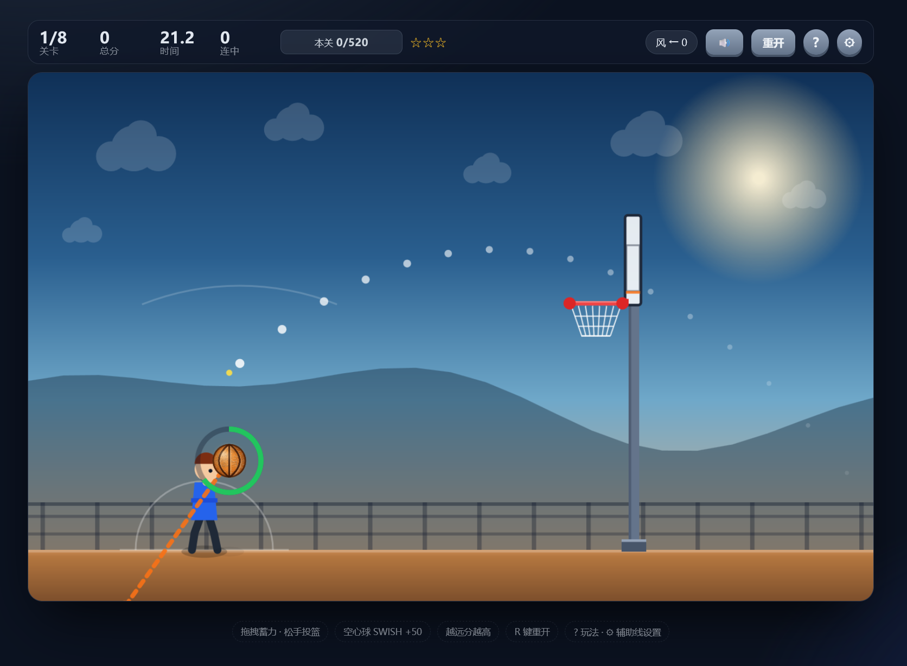

# 🏀 怒篮 · 篮球抛物线挑战

> 拉弹弓式的篮球投篮小游戏 —— **单文件、零依赖，双击 `index.html` 即玩**。



拖住篮球向后拉，松手投篮。拖得越远力量越大，拖拽方向就是球的出射方向；
空心入网有额外奖励，注意风力和移动篮架。

---

## 🎮 怎么玩

1. **按住**篮球（需点在球的 150px 范围内），像拉弹弓一样**向后拖拽**蓄力
2. 拖拽距离决定力度（绿 → 黄 → 红），拖拽方向决定出射角度
3. **松手**投篮 —— 角色会走一段完整的跳投动画：下蹲蓄力 → 起跳 → **最高点出手** → 落地
4. 把球送进篮筐即可得分，**空心入网（不碰篮圈）额外 +50**

因为球是在**起跳最高点**才脱手的，出手位置比站立时高出 96px，
且出手点会随仰角前后微调，所以同一根「拉杆」在不同角度下并不等价 —— 需要多练几次找手感。

> 也可以打「反弹」：第 5 / 7 / 8 关的挡板不只是障碍，擦板进球同样算数。

---

## ⌨️ 操作

| 输入 | 作用 |
|---|---|
| 鼠标 / 触摸拖拽 | 蓄力瞄准与投篮（按在球附近起手） |
| `R` | 重开本局 |
| `H` / `?` | 打开玩法说明 |
| `Esc` | 关闭当前面板 |

---

## 🎯 瞄准辅助线

拖拽时会出现瞄准辅助，强度分三档，可随时切换（**⚙ 设置** 或 **玩法说明** 面板里都能改，选择会被记住）：

| 档位 | 说明 |
|---|---|
| **抛物线**（默认） | 白色渐隐弧线，只算重力和风，**不告诉你能不能进** —— 新手引导用 |
| **弹道预览** | 考虑全部碰撞：<br>· 路径点碰到篮圈 / 篮板后会变**琥珀色**<br>· **绿圈** = 能进，**橙叉** = 会打铁<br>· 移动篮架会额外画出球到达那一刻的**虚线篮圈**，提前量一目了然 |
| **关闭辅助** | 只保留拉杆和力度环，完全凭手感，最接近真实篮球 |

---

## 📊 计分规则

单次进球得分：

| 项目 | 分值 |
|---|---|
| 基础分 | **100** |
| 距离分 | 距离 ÷ 11（投得越远分越高） |
| 时间分 | 剩余时间 × **4** |
| 空心球 | **+50** |
| 连击 | 每次 **+25**（每关重置，一球不中即清零） |

- **过关奖励**：达标瞬间结算剩余时间 × **5**
- **星级**：单球 ≥330 三星 / ≥300 二星 / 其余一星，每关取本关最佳单球的星级

---

## 🗺️ 关卡

8 关递进，每关有目标分与限时（左上角进度条即本关目标），达标立刻过关并结算时间奖励；时间耗尽也会进入下一关，只是没有奖励。

| 关 | 目标分 | 限时 | 篮宽 | 特殊条件 |
|:--:|:--:|:--:|:--:|---|
| 1 | 520 | 30s | 60 | 基础投篮 |
| 2 | 560 | 30s | 60 | 更远更高，弧线要压低 |
| 3 | 600 | 28s | 58 | 🔄 篮架上下移动 |
| 4 | 640 | 28s | 54 | 🌬 顺风助推 |
| 5 | 680 | 26s | 56 | 🌬 逆风 + 高篮 + 挡板 |
| 6 | 720 | 26s | 54 | 🔄 篮架左右平移，打时间差 |
| 7 | 760 | 24s | 54 | 🌬 大风 + 高位移动篮架 + 障碍 |
| 8 | 800 | 24s | 54 | 🌬 逆风 + 平移篮架 + 双障碍（终极考验） |

---

## ✨ 技术特点

- **单文件零依赖** —— 整个游戏就是一个 `index.html`，HTML + CSS + JS 全内联，没有构建步骤、没有 npm 包、不用联网
- **Canvas 2D + 高分屏适配** —— 960×600 逻辑分辨率，按 `devicePixelRatio`（上限 2×）缩放，篮球纹理在 resize 时按 dpr 重新烘焙
- **Web Audio 实时合成音效** —— 没有任何音频文件，跳跃 / 落地 / 出手 / 碰筐 / 空心 / 得分 / 结束音全部由振荡器与噪声缓冲实时合成
- **弹道预览「所见即所得」** —— 预览用的 `simulateShot()` 与实际飞行的 `updateFly` 同源：相同步长、相同碰撞系数、相同判定顺序、相同碰撞体清单，干净弹道虚影偏差 < 2px
- **出手点同源** —— 预览与实际统一走 `releaseOrigin()`，实测偏差 **0.000px**
- **物理参数集中可调** —— 重力、空气阻力、最大初速、跳投高度等都集中在文件顶部，改数值即可调手感
- **克制的辅助线** —— 辅助画得越满，打铁就越难发生。默认档只给理想弧线而不承诺结果，纠偏能力放在第二档交给玩家自选

---

## 🚀 运行

**方式一：直接打开**

双击 `index.html`，或：

```bash
start index.html        # Windows
open index.html         # macOS
xdg-open index.html     # Linux
```

**方式二：本地服务器（可选）**

Python：

```bash
python -m http.server 8000
# 然后访问 http://localhost:8000
```

Node.js：

```bash
npx serve -l 8000
```

Nginx（把 `index.html` 放到站点根目录后）：

```nginx
server {
    listen       80;
    server_name  localhost;

    root   /var/www/nulan;   # 存放 index.html 的目录
    index  index.html;

    location / {
        try_files $uri $uri/ =404;
    }
}
```

```bash
nginx -t          # 检查配置
nginx -s reload   # 重载生效
# 然后访问 http://localhost
```

> nginx 需要自行安装（如 `apt install nginx` / `brew install nginx` / [官网](https://nginx.org)）。

现代浏览器（Chrome / Edge / Firefox / Safari）均可直接运行。

---

## 📄 License

MIT © [kevinvane](https://github.com/kevinvane) —— 详见 [LICENSE](LICENSE)
